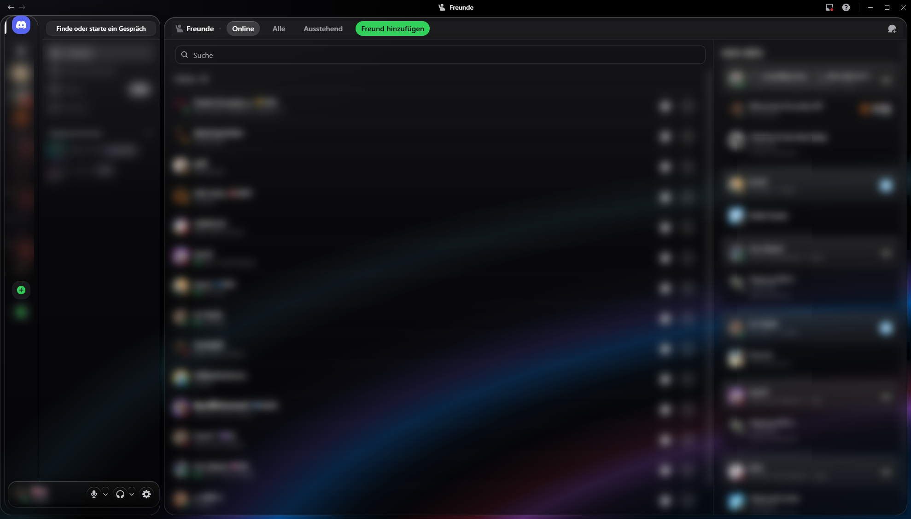
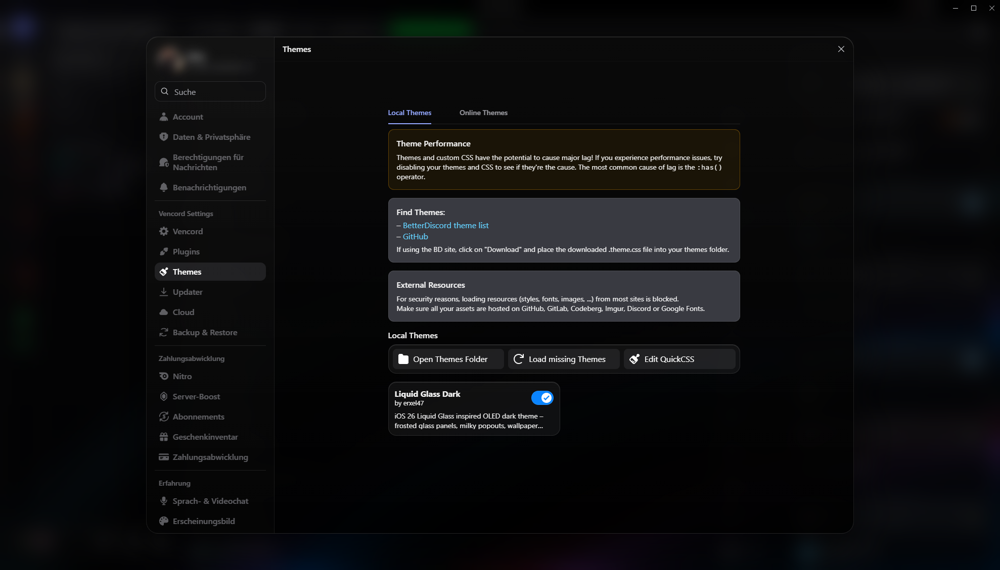

# Liquid Glass Dark

An **iOS 26 Liquid Glass** inspired theme for Discord: OLED black, frosted glass panels, dark milky popouts and soft glowing wallpapers.

Works with **Vencord** and **BetterDiscord**. Tested with Vencord.

## Features

- **OLED black** base with floating, rounded glass panels and light edges
- **Dark milky glass** for menus, popouts, profiles, the emoji picker and the new settings window
- **5 wallpaper presets**: Leuchtbögen (glow arcs), Mitternacht (midnight), Sunset, Aurora, Schleier (veil)
- **iOS-style controls**: pill buttons, green toggles, segmented tabs and iOS system colors
- **Performance-friendly**: no `:has()` selectors, and blur only where something sits behind it
- Works with Discord's 2025 visual refresh and the new settings modal

## Installation

### Vencord
1. Download [`LiquidGlass.theme.css`](LiquidGlass.theme.css).
2. In Discord, go to **Settings → Vencord → Themes → Open Themes Folder**.
3. Put the file in that folder and switch the theme on.

### BetterDiscord
1. Download [`LiquidGlass.theme.css`](LiquidGlass.theme.css).
2. In Discord, go to **Settings → BetterDiscord → Themes → Open Themes Folder**.
3. Put the file in that folder and switch the theme on.

## Customization

All settings are at the top of the file, in `:root`.

| Variable | What it does |
|---|---|
| `--lg-wallpaper` | Selects the wallpaper: `var(--lg-wp-bogen)`, `var(--lg-wp-mitternacht)`, `var(--lg-wp-sunset)`, `var(--lg-wp-aurora)` or `var(--lg-wp-schleier)`. Use `#000` for pure OLED black, or `url("…")` for your own image. |
| `--lg-blur` | Blur strength. Higher looks nicer but is slower. |
| `--lg-tint` | How dark or see-through the main panels are |
| `--lg-milk-bg` | The material for popouts, menus and settings |
| `--lg-accent` | Accent color (default: iOS blue `#0a84ff`) |

If your PC is slow, set `--lg-blur` to `12px`.

## Deutsch

Ein iOS-26-„Liquid Glass“-Theme für Discord: OLED-Schwarz, Glas-Panels, dunkles Milchglas für Menüs und Einstellungen und fünf Wallpaper-Vorlagen. Zur Installation die `.theme.css` in den Themes-Ordner von Vencord oder BetterDiscord legen. Alle Einstellungen stehen oben in der Datei.

---

Not affiliated with Apple or Discord.
